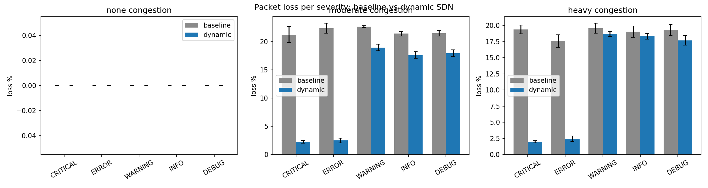
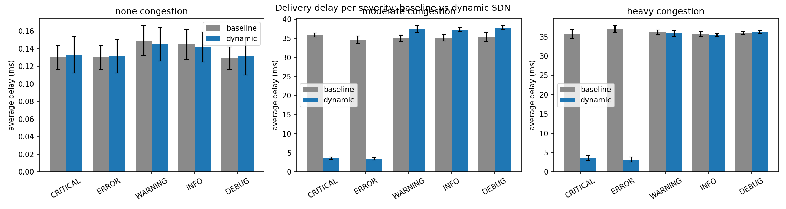
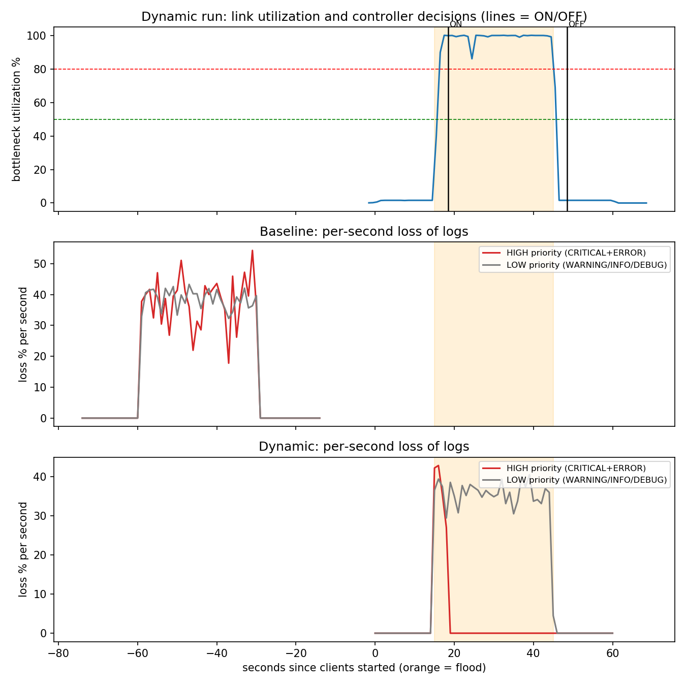

# SDN-Based Distributed Log Aggregation System

Multiple hosts send timestamped, severity-tagged application logs over **UDP** to a central
log server through a **Mininet** network controlled by a **Ryu (OpenFlow 1.3)** SDN controller.
When the bottleneck link becomes congested, the controller dynamically **prioritizes critical
logs** using OVS queues. We measure packet loss and delivery time per severity and compare the
dynamic approach with a static (baseline) controller.

Course: SDN-Socket Programming, Jackfruit Mini Project.

## How it works (short version)

```
 h1..h4 (log clients) --\
 h6 (congestion gen.) ---+-- s1 ====== s2 -- h5 (log server)
                              10 Mbps bottleneck (s1-eth6)
                  Ryu controller <-- OpenFlow --> s1, s2
```

- Clients send logs as UDP datagrams; the **destination port encodes the severity**
  (5001 = CRITICAL/ERROR, 5002 = WARNING/INFO, 5003 = DEBUG), so the network can classify traffic.
- The controller polls the bottleneck port every second. If utilization stays above 80 % for
  3 consecutive intervals it installs rules that send port 5001 to a high-priority queue and
  everything else to a low-priority queue; below 50 % for 3 intervals it removes them.
- `baseline` mode uses the same controller code but never prioritizes.

Details: [docs/architecture.md](docs/architecture.md), interface definitions: [docs/contract.md](docs/contract.md),
demo steps: [docs/demo_script.md](docs/demo_script.md).

## Repository layout

| Path | Contents |
|---|---|
| `app/` | `log_client.py`, `log_server.py`, `common.py` (UDP application) |
| `controller/` | `sdn_controller.py` (dynamic), `baseline_controller.py` (no prioritization) |
| `topology/` | `topo.py` (Mininet topology and OVS queues), `README.md` |
| `experiments/` | `run_experiments.py`, `aggregate.py`, `plot_results.py` |
| `docs/` | contract, architecture, demo script, `results/` (CSV), `figures/` (plots) |
| `results/` | raw per-run output (generated, not committed) |

## Requirements

Ubuntu 20.04 (Python 3.8), Mininet, Open vSwitch, iperf, Ryu 4.34 with `eventlet==0.30.2`,
matplotlib (plots only). Mininet and Open vSwitch need Linux, so on a Mac use a VM (we used
UTM with Ubuntu 20.04 Server ARM64).

```bash
sudo apt update
sudo apt install -y mininet openvswitch-switch iperf python3-pip python3-venv python3-matplotlib git
sudo systemctl enable --now openvswitch-switch

python3 -m venv ~/ryu-env
source ~/ryu-env/bin/activate
pip install --upgrade pip wheel "setuptools<59"
pip install "eventlet==0.30.2" ryu
ryu-manager --version          # should print 4.34
```

Check the environment: `sudo mn --test pingall` should report 0 % dropped.

## Running it

### A. Automated (recommended)

Runs every experiment with a fresh controller and network, then collect results:

```bash
sudo python3 experiments/run_experiments.py --runs 1 --conditions heavy   # quick check (~3 min)
sudo python3 experiments/run_experiments.py                               # full matrix (~30 min)
python3 experiments/aggregate.py                                          # tables -> docs/results/
python3 experiments/plot_results.py                                       # figures -> docs/figures/
```

The matrix is 3 conditions (`none`, `moderate` = 12 Mbps flood, `heavy` = 15 Mbps flood) x
2 modes (`baseline`, `dynamic`) x 3 repeats. Each run lasts 60 s; the flood is a burst from
t = 15 s to t = 45 s.

### B. Manual (for demos and debugging)

Terminal 1 (inside the Ryu virtualenv, from the repo root):
```bash
mkdir -p results/demo
RUN_ID=demo ryu-manager controller/sdn_controller.py          # or controller/baseline_controller.py
```
Terminal 2:
```bash
sudo python3 topology/topo.py
```
At the `mininet>` prompt:
```
pingall
h5 iperf -s -u -p 5004 > /dev/null 2>&1 &
h5 python3 app/log_server.py --out results/demo --idle-timeout 8 > /tmp/srv.out 2>&1 &
h1 python3 app/log_client.py --host-id h1 --server-ip 10.0.0.5 --rate 50 --duration 40 --out results/demo > /tmp/h1.out 2>&1 &
h2 python3 app/log_client.py --host-id h2 --server-ip 10.0.0.5 --rate 50 --duration 40 --out results/demo > /tmp/h2.out 2>&1 &
h3 python3 app/log_client.py --host-id h3 --server-ip 10.0.0.5 --rate 50 --duration 40 --out results/demo > /tmp/h3.out 2>&1 &
h4 python3 app/log_client.py --host-id h4 --server-ip 10.0.0.5 --rate 50 --duration 40 --out results/demo > /tmp/h4.out 2>&1 &
h6 bash -c "sleep 5; iperf -u -c 10.0.0.5 -p 5004 -b 15M -t 30" > /tmp/flood.out 2>&1 &
```
After about 55 s: `sh cat /tmp/srv.out` shows the per-severity summary.

Cleanup: `exit`, Ctrl+C the controller, `sudo mn -c`.
Always use a new `results/<name>` folder per run, and stop the old controller before starting another.

## Output files (per run, in `results/<run_id>/`)

| File | Content |
|---|---|
| `server_log.csv` | `recv_time, client_id, seq, severity, send_time, delay_ms` |
| `client_sent_<host>.csv` | every message actually sent (used to compute loss) |
| `summary.json` | per-severity sent, received, loss %, average / p95 / max delay |
| `controller_log.csv` | `time, event, utilization, action` (STATS every second, congestion decisions) |
| `flow_stats.csv` | per-severity flow packet and byte counters over time |

## Results

Averages over 3 runs per case (mean ± standard deviation). Generated by `experiments/aggregate.py`;
raw tables in `docs/results/`.

<!-- TODO: paste the markdown table printed by `python3 experiments/aggregate.py` here -->





**Congestion burst over time** (utilization, controller decisions, per-second loss of high- and
low-priority logs):



### Findings

<!-- TODO: after pasting the table, edit these to match the real numbers -->
- Without congestion, both modes deliver everything with sub-millisecond delay; the controller stays idle.
- Under congestion, the baseline treats all severities equally (loss and delay about the same for every severity).
- With dynamic prioritization, CRITICAL and ERROR logs see much lower loss and delay, while the
  low-priority classes absorb the loss. Total loss stays about the same because link capacity is unchanged.
- The controller needs about 3 seconds of sustained congestion before reacting, so a small amount of
  high-priority loss remains at the start of each burst.

## Design notes and limitations

- Severity is carried by the UDP destination port because the controller can match ports but cannot read payloads.
- The bottleneck is enforced in one place: an OVS HTB QoS on `s1-eth6` (10 Mbps, queue 1 high, queue 2 low,
  queue 0 default, 100-packet buffer).
- Delay is measured as receive time minus send time; this is valid because all emulated hosts share one machine clock.
- Utilization is computed from the transmit counter of the bottleneck port; it can read slightly above 100 %
  when packets are dropped after being counted.
- Results come from an emulated network inside a VM, so absolute numbers depend on the host machine; the
  relative comparison (baseline vs dynamic) is what the experiments show.

## Team

| Member | Role |
|---|---|
| Vineeth (Member A) | UDP application, repository, experiment automation and evaluation |
| [Name] (Member B) | SDN controller (initial version) |
| [Name] (Member C) | Mininet topology (initial version) |

<!-- TODO: adjust the roles above to reflect who actually did what -->
