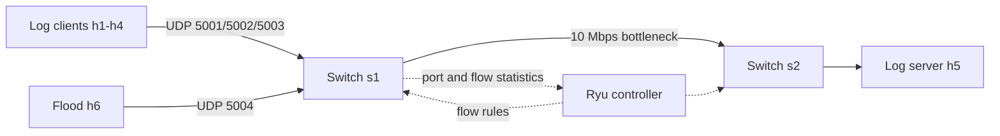

# Architecture

## 1. Problem and objectives

Applications on several hosts produce logs of different importance. All logs travel to one
central server over UDP, which gives no delivery guarantee. When the network is congested, UDP
packets are simply dropped, and an ordinary network drops important and unimportant logs alike.

**Objective:** use Software-Defined Networking so that, during congestion, CRITICAL and ERROR logs
are delivered preferentially, and quantify the benefit by measuring packet loss and delivery time
against a static baseline.

Requirements covered (from the project brief): UDP log clients, a centralized log server,
timestamps, severity categories, network-flow statistics, prioritization of critical logs,
controlled congestion, and measurement of loss and delivery time.

## 2. System overview

```
   h1 (10.0.0.1) --\
   h2 (10.0.0.2) ---\
   h3 (10.0.0.3) ----+-- s1 ============= s2 -- h5 (10.0.0.5) log server
   h4 (10.0.0.4) ---/   s1-eth6 (10 Mbps bottleneck)
   h6 (10.0.0.6) --/
   congestion generator
                              ^
                              | OpenFlow 1.3
                        Ryu controller
```



## 3. Components

| Component | Implementation | Responsibility |
|---|---|---|
| Log clients (h1-h4) | `app/log_client.py` | Generate logs at a set rate with a configurable severity mix; send each as a UDP datagram to the port for its severity; record every message sent |
| Log server (h5) | `app/log_server.py` | Listen on UDP ports 5001-5003 (one thread per port); validate and timestamp each log; write `server_log.csv`; compute per-severity loss and delay |
| Congestion generator (h6) | `iperf` UDP | Send a controlled burst (12 or 15 Mbps) toward the server on port 5004 |
| Topology | `topology/topo.py` (Mininet) | 6 hosts, 2 OVS switches, fixed port numbers; 10 Mbps HTB QoS with two priority queues on `s1-eth6` |
| Controller | `controller/sdn_controller.py` (Ryu) | Learning-switch forwarding, per-severity flow rules, statistics polling, congestion detection, dynamic queue rules |
| Baseline controller | `controller/baseline_controller.py` | Same code, but never prioritizes (comparison) |
| Experiment tooling | `experiments/*.py` | Automate runs, aggregate results, make figures |

## 4. Communication flow

**Message format (UDP payload, UTF-8, at most 512 bytes):**
`seq|timestamp|host_id|severity|message` (sequence number per client, send time in epoch seconds,
sender, severity, free text).

**Severity to port mapping** (the controller can match ports but cannot read payloads):

| Severity | UDP port | Class |
|---|---|---|
| CRITICAL, ERROR | 5001 | High priority |
| WARNING, INFO | 5002 | Low priority |
| DEBUG | 5003 | Low priority |
| Flood (iperf) | 5004 | Low priority, not a log |

**Path of one log:**
1. A client builds the message and sends it to 10.0.0.5 on the port for its severity.
2. s1 matches a standing flow rule (UDP, destination 10.0.0.5, port 500x) and forwards toward s2 via port 6.
3. At the bottleneck port the packet waits in a queue. During congestion the queue it joins depends on the
   dynamic rules (high-priority queue for port 5001, low-priority queue otherwise).
4. s2 forwards the packet to h5; the server records the receive time and delay.
5. Loss is computed as (messages in the client's sent file) minus (messages in the server log).

## 5. Controller design

**Flow rules (higher priority number wins):**

| Priority | Rule | When |
|---|---|---|
| 0 | Table-miss: send to controller | Always |
| 1 | Learned MAC forwarding (learning switch, ARP) | Always |
| 100 | UDP to 10.0.0.5, ports 5001/5002/5003: output toward server (counts packets per severity) | Always |
| 200 | Same matches with `set_queue`: 5001 to queue 1 (high); 5002, 5003, 5004 to queue 2 (low) | Only while congested (s1) |

**Statistics and detection:** every second the controller reads the transmit counter of `s1-eth6`,
converts it to Mbps, and divides by 10 Mbps to get utilization. It also reads flow counters
(`flow_stats.csv`).

- Congestion ON: utilization above 80 % for 3 consecutive intervals; install priority-200 rules.
- Congestion OFF: utilization below 50 % for 3 consecutive intervals; delete them.
- Two thresholds plus the 3-interval rule give hysteresis, which prevents flapping on short spikes.

Every decision is logged with a timestamp to `controller_log.csv`.

**Queues:** an OVS HTB QoS on `s1-eth6` limits the link to 10 Mbps with queue 1 (min 7 Mbps, served first),
queue 2 (min 1 Mbps) and the default queue 0. The transmit queue is 100 packets, so congestion appears as
loss within seconds and delay is bounded near 120 ms.

## 6. Expected network behavior

| Scenario | Expected behavior |
|---|---|
| No congestion | No loss, delay well under 1 ms, controller idle |
| Congestion, baseline | All severities lose roughly the same share of packets and see the same delay |
| Congestion, dynamic | After about 3 s the controller switches prioritization on; CRITICAL/ERROR loss and delay drop sharply; WARNING/INFO/DEBUG absorb most of the loss; prioritization is removed after the burst |

## 7. Design decisions and trade-offs

- **Port-based classification** is simple and visible to the controller; the cost is that the application must
  cooperate by choosing the port.
- **Queues rather than dropping low-priority logs.** DEBUG traffic is tiny compared with the flood, so dropping it
  would free almost no capacity. Queues decide who is served first when capacity is short.
- **One baseline codebase.** Baseline and dynamic share all code except the prioritization step, so the comparison
  changes one variable.
- **Reaction time vs stability.** Requiring 3 consecutive intervals avoids false triggers but leaves a short
  unprotected window at the start of a burst.
- **Single bottleneck.** Keeps the experiment controlled; real networks have many.

## 8. Measurement method

- **Loss:** from the client's sent file versus the server's received log, per severity (exact, not estimated).
- **Delay:** receive time minus send time; valid because all emulated hosts share one clock.
- **Statistics reported:** average, 95th percentile and maximum delay, plus loss percentage, over 3 repeats per case.
- **Controlled congestion:** flood of 12 Mbps (moderate) or 15 Mbps (heavy) starting 15 s into a 60 s run and lasting 30 s.

## 9. Limitations

- Emulation inside a VM; absolute numbers vary with host load.
- Utilization comes from the transmit counter, which can exceed 100 % when packets are dropped after counting.
- Only one switch pair and one bottleneck; no redundant path or link-failure handling.
